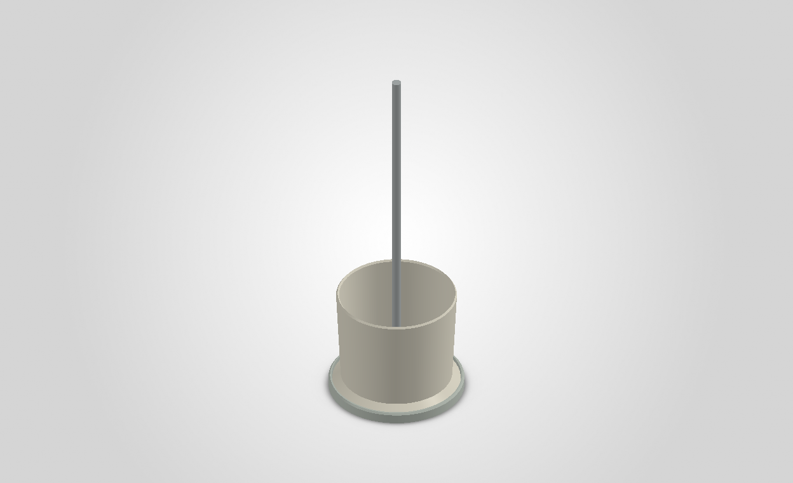
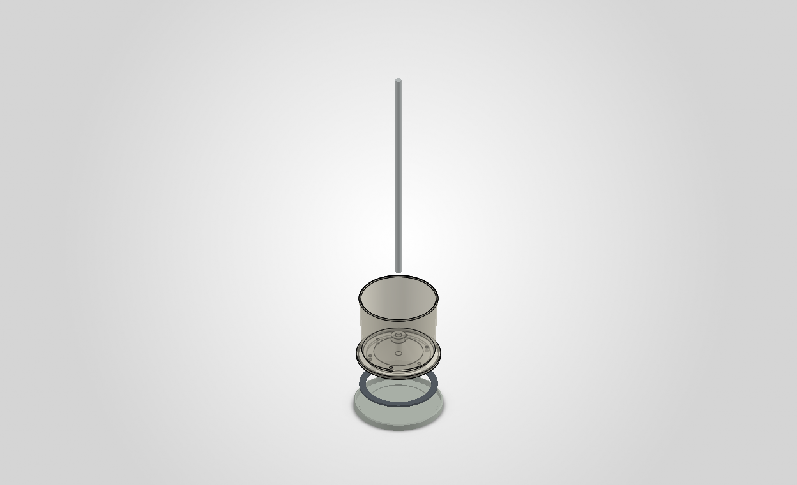
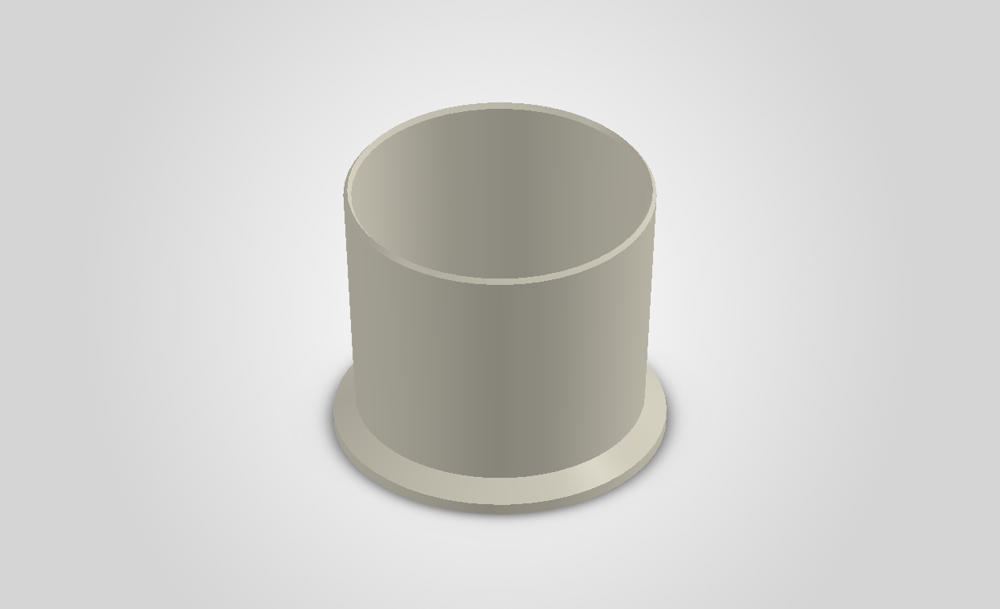
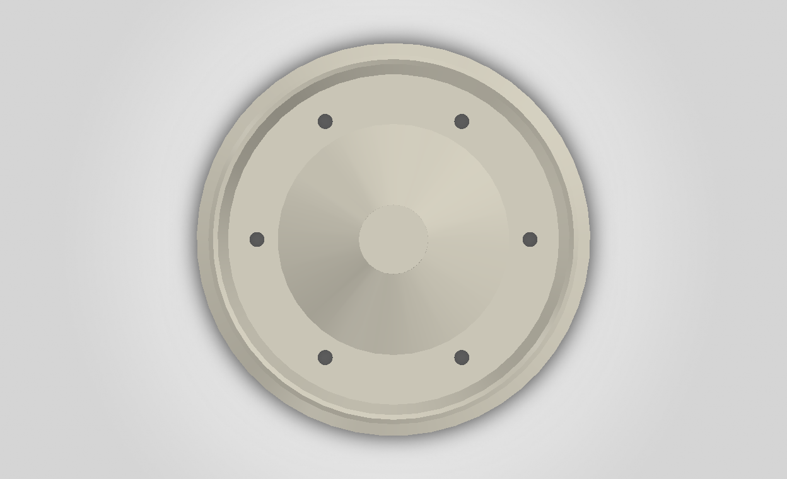
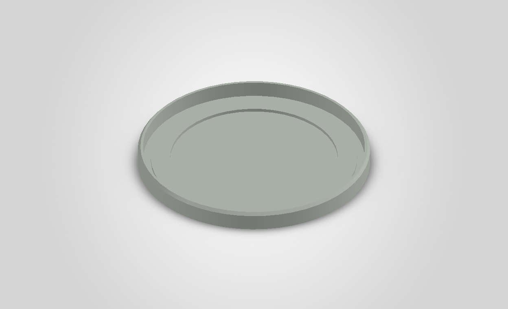
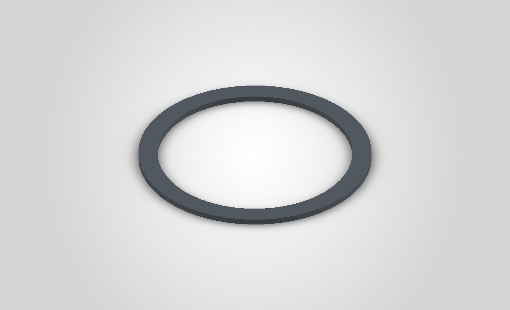

# Integrated Central-Support Monstera Planter

A practical planter redesign for climbing Monstera plants. The project addresses a common problem with conventional support poles: when a loose pole is pushed into the soil, it can wobble, lean, and eventually pull the plant off balance.

The proposed design places a removable support pole on the exact centerline of the planter and transfers its bending load directly into a reinforced socket in the planter base. A wide footprint and a low steel ballast ring improve stability in every direction, while excess irrigation water drains into a removable saucer.

## Design goals

- Keep the support pole stable without relying on compacted soil.
- Maintain equal resistance to tipping in every direction.
- Avoid a permanent water reservoir and the associated root-rot and cleaning risks.
- Keep the product simple enough to manufacture and assemble.
- Make the pole, saucer, and ballast independently replaceable.

## How it works

1. The 25 mm support pole seats 92 mm into a central blind socket.
2. A 360-degree conical gusset distributes pole loads into the planter floor.
3. Six drainage holes carry excess water directly to the removable saucer.
4. A concealed steel ring lowers the center of gravity.
5. The 340 mm stabilizing foot provides a wider base than the soil container.

## Main dimensions

| Parameter | Value |
|---|---:|
| Planter top outside diameter | 320 mm |
| Stabilizing foot diameter | 340 mm |
| Planter height | 285 mm |
| Approximate usable soil depth | 262 mm |
| Support pole | Ø25 × 950 mm |
| Pole insertion depth | 92 mm |
| Saucer | Ø360 mm, 30 mm lip |
| Drainage | 6 × Ø13 mm |
| Ballast ring | Ø318 / Ø266 × 8 mm |
| Approximate ballast mass | 1.46 kg |

## Components

| Component | Function |
|---|---|
| Planter body | Soil container, drainage floor, and integrated central socket |
| Central support pole | Supports the climbing plant |
| Drainage saucer | Collects excess water and can be removed for cleaning |
| Ballast ring | Improves tip resistance by lowering the center of gravity |

## Design details

| Planter interior | Top view |
|---|---|
|  |  |

| Support pole | Drainage saucer | Ballast ring |
|---|---|---|
|  |  |  |

## Suggested materials

- Planter and saucer: UV-stabilized polypropylene for production, or PETG for a large-format prototype.
- Support pole: anodized aluminium tube, sealed hardwood dowel, or glass-filled polymer.
- Ballast: powder-coated carbon steel or stainless steel.

## Repository contents

- Native editable SolidWorks part and assembly files (`.SLDPRT`, `.SLDASM`)
- Standard and exploded assemblies
- Component and assembly renders
- Detailed design specification
- Downloadable CAD package (`.zip`)

## Status

Concept design completed in SolidWorks. Before production, the design should undergo a loaded tilt test, drainage-flow testing, tolerance validation, and design-for-manufacturing review.

---

Designed as a compact product-development case study: identifying a real everyday problem, defining functional requirements, and developing a manufacturable mechanical solution.
